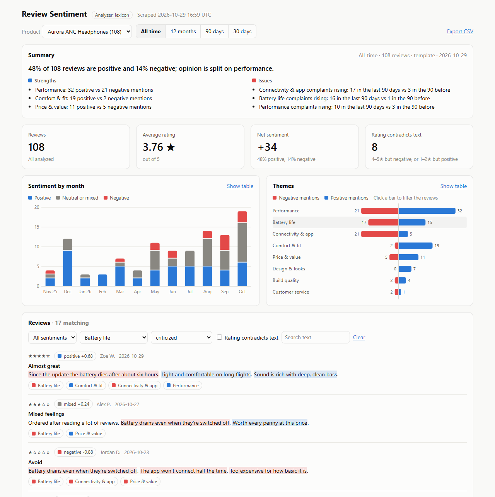
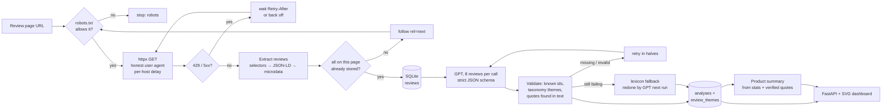

# Review Sentiment Dashboard

Scrapes a product's reviews, has GPT score each one for sentiment and tag the themes it talks about with a quote as evidence, and charts the results in a small web dashboard.

A product with hundreds of reviews has a 4.2-star average, and that average hides what matters: battery complaints tripled after last month's firmware update, or a new sole supplier is making boots fall apart. Reading every review doesn't scale, and keyword counting misses sarcasm ("oh fantastic, it broke again"), negation ("not bad at all") and reviews in other languages. This project **scrapes the reviews** (JSON-LD, microdata, or CSS selectors), sends them to **GPT in batches with a strict JSON schema**, and **checks the answer against the review text**: every quote must actually appear in the review, and themes must come from a fixed taxonomy. The dashboard shows sentiment over time, praise vs. complaints per theme, star ratings that contradict the text, and a generated summary. Without an API key, an offline lexicon analyzer takes over, so everything still runs.



*The screenshot is from a real run with the offline lexicon analyzer, because no OpenAI key was available when it was taken. The two analyzers fill the same dashboard. To regenerate it with GPT, see [Tests and tooling](#tests-and-tooling).*

## How it works



**Scraping** ([reviewdash/scraper.py](reviewdash/scraper.py), [reviewdash/extract.py](reviewdash/extract.py))

- Review pages are usually server-rendered for search engines, so plain httpx is enough and much lighter than a browser. Project #2 (`price-tracker-scraper`) covers the headless-browser case.
- Three extraction strategies, tried in order: CSS selectors saved for the product, schema.org **JSON-LD** (including `@graph` and nested `Product.review`), and schema.org **microdata** (properties are scoped to their own item, so a product's `name` never becomes a review title). Ratings are normalized to a 0–5 scale from `9/10`, `4.5 out of 5`, `★★★★☆` or `bestRating`. Dates parse from ISO, `March 2, 2026`, `Reviewed in the United States on …` and `3 days ago`.
- **Incremental.** Pages are read newest first, and the walk stops at the first page whose reviews are all already stored. `--full` re-reads everything. An edited review gets a new content hash, which updates the row and triggers re-analysis.
- **Polite.** It sends an honest user agent, honors robots.txt (a 401/403 robots.txt means "disallow all"), waits for `Retry-After` on 429/503 (capped at 2 minutes), keeps a minimum gap between requests to one host, and stops at `MAX_PAGES`. Following a `next` link that loops back is detected.

**Analysis** ([reviewdash/llm.py](reviewdash/llm.py))

- For each review, the model returns `sentiment` (positive / neutral / mixed / negative), a `score` from -1 to 1, `themes` (each with polarity and a quote of 15 words or fewer), and a 12-word summary. Reviews go 8 per call, with 3 calls in flight at once.
- With `LLM_JSON_MODE=json_schema`, OpenAI **structured outputs** constrain the response to the schema, and the theme field is an `enum` of the taxonomy in [reviewdash/themes.json](reviewdash/themes.json). The output is still validated, because the schema can't check everything:
  - ids the model skipped, mangled or invented are caught, and the missing reviews are **retried in halves**, so one odd review can't sink its neighbors;
  - a quote that isn't in the review (after normalizing case, whitespace and curly quotes) is dropped, but the theme is kept;
  - themes outside the taxonomy are dropped (`Ease of Use` is normalized to `ease_of_use` first);
  - whatever still fails gets a **lexicon analysis marked `lexicon`**. The next run hands those reviews back to the LLM.
- **The model doesn't see the star rating.** Sentiment comes from the text alone, which is what makes "4–5★ but negative" a meaningful signal on the dashboard.
- **Prompt injection.** Review text is untrusted, so it travels as JSON data in the user turn, and the system prompt says never to follow instructions inside it. Validation limits what a successful injection could do: it can't add a theme, invent a quote, or touch another review's id. The demo data includes a review that tries this.
- **Errors.** A bad key, an unknown model or an unsupported option (401/403/404/400) stops the run on the first call with a clear message, instead of retrying hundreds of batches. A 400 suggests `LLM_JSON_MODE=json_object`. 429 and 5xx errors are retried by the OpenAI SDK, and a timeout fails only its own batch.
- **Cost control.** A review is analyzed once, unless its text changes or `--reanalyze` is passed. `MAX_REVIEWS_PER_RUN` caps a run, `max_tokens` caps each call, and the run log records calls and tokens.
- Any OpenAI-compatible server works: set `OPENAI_BASE_URL`, e.g. `http://localhost:11434/v1` for Ollama. Use `LLM_JSON_MODE=json_object` if the server doesn't support structured outputs.

**Summary panel** ([reviewdash/stats.py](reviewdash/stats.py)). The model doesn't see raw reviews here. It gets numbers: sentiment counts, mentions per theme, themes whose praise or complaints at least doubled in the last 90 days, and up to 3 recent **verified** quotes per theme. Its output is cached and only regenerated when those numbers change. Without an LLM, a template writes the same panel from the same facts.

**Dashboard** ([reviewdash/web.py](reviewdash/web.py), [reviewdash/static/](reviewdash/static/)). A read-only JSON API and a single page with hand-drawn SVG charts (no chart library):

- Stat tiles: review count, average rating and net sentiment (% positive − % negative), each compared with the previous period of the same length, plus a count of reviews whose stars contradict their text.
- Stacked monthly columns of positive, neutral or mixed, and negative reviews.
- A diverging bar per theme. Click the red half for complaints, the blue half for praise.
- A review list with sentiment, themes, the model's summary, and the evidence quotes highlighted in the text. You can filter by sentiment, theme, praised or criticized, rating/text contradiction, or text search.
- Every chart has a table view. Tooltips work on keyboard focus. Dark mode is supported, and the layout works at phone width.
- Export to CSV. Review text is written by strangers, so cells starting with `=`, `+`, `-` or `@` are prefixed so that Excel won't run them as formulas.

## Tech stack

- Python 3.12, asyncio
- httpx and Beautiful Soup 4 for scraping
- OpenAI Python SDK (chat completions with structured outputs), Pydantic for validation
- SQLite (stdlib `sqlite3`)
- FastAPI and Uvicorn for the API, plain JavaScript and SVG for the dashboard
- Typer and Rich for the CLI
- Docker Compose with a bundled demo store to scrape
- pytest: 105 tests, no network or API key needed. The LLM tests run the real OpenAI SDK against a fake endpoint (`httpx.MockTransport`), and the scraper tests run against the demo store in-process.

## Run it

### Docker

```bash
cp .env.example .env          # optional: add OPENAI_API_KEY; without it the lexicon analyzer is used
docker compose up --build
```

- **Dashboard:** http://localhost:8000
- **Demo store:** http://localhost:8090, the fake shop that gets scraped ([see below](#the-demo-store))

On startup, the dashboard container adds the four demo products, scrapes them, analyzes the reviews and writes the summaries, then serves the dashboard. To see incremental scraping, add some new reviews and refresh:

```bash
curl -X POST "http://localhost:8090/admin/new-reviews?slug=aurora-anc-headphones&count=5"
docker compose exec dashboard python -m reviewdash refresh
```

### Locally

```bash
python -m venv .venv
source .venv/bin/activate                 # Windows: .venv\Scripts\activate
pip install -r requirements-dev.txt
cp .env.example .env                      # add OPENAI_API_KEY (or OPENAI_BASE_URL for Ollama)

python -m demo_store                      # terminal 1: demo store on :8090
python -m reviewdash seed-demo            # terminal 2
python -m reviewdash refresh              # scrape + analyze + summarize
python -m reviewdash serve                # http://127.0.0.1:8000
```

### Tests and tooling

```bash
pytest                                    # 105 tests, no API key needed
python scripts/evaluate.py                # score the analysis against the demo store's ground truth
python scripts/make_screenshot.py         # regenerate docs/screenshot.png (needs: pip install playwright)
```

## Analyze a real product

```bash
python -m reviewdash add "https://shop.example.com/products/kettle/reviews"
python -m reviewdash scrape
```

If a scrape reports `no_reviews`, the page has no structured review data. Inspect one review in your browser and save selectors. Each value is `css` for an element's text, `css@attr` for an attribute, or `@attr` for an attribute of the review element itself:

```bash
python -m reviewdash add "https://shop.example.com/products/kettle/reviews" --selectors '{
  "review": "div.review", "id": "@data-review-id", "body": ".review-text", "title": "h3",
  "author": ".author", "rating": ".stars@aria-label", "date": "time@datetime", "next": "a.next-page"
}'
```

`review` and `body` are required. Re-running `add` with the same URL updates the selectors. Check the site's terms of service before scraping it, and keep `REQUEST_DELAY_SECONDS` generous.

## CLI

| Command | What it does |
| --- | --- |
| `add URL [--name] [--selectors JSON\|file]` | Track a review page (re-adding updates the name and selectors) |
| `list` | Products with review counts, analysis coverage, average rating and last scrape |
| `scrape [IDS...] [--full]` | Fetch new and edited reviews |
| `analyze [IDS...] [--reanalyze] [--limit N]` | Analyze reviews that are new, edited, or only have a lexicon fallback |
| `summarize [IDS...] [--force]` | Regenerate summaries whose underlying numbers changed |
| `refresh [IDS...]` | scrape + analyze + summarize |
| `runs` | Recent runs, with page counts, fallbacks, token usage and errors |
| `remove ID` | Delete a product and its reviews |
| `seed-demo [--base-url]` | Track the demo store's four products |
| `serve [--host] [--port]` | Run the dashboard (API docs at `/api/docs`) |

Add `-v` before the command to log every request and LLM batch.

## The demo store

[demo_store/](demo_store/) is a small FastAPI shop with made-up products. It's there so the project can be demoed and tested without scraping real sites. Each product publishes reviews in a different way, and each has a story for the dashboard to find:

| Product | Markup | Story in the data |
| --- | --- | --- |
| Aurora ANC Headphones | microdata | Firmware update ~80 days ago: battery and Bluetooth complaints jump |
| Ember Gooseneck Kettle | JSON-LD in `<head>`, plain HTML body | Boxes damaged in shipping over December and January |
| Ridgeline Trail Boots | plain HTML, no structured data (needs selectors) | Soles separating in the last two months; sizing runs small |
| Nimbus Robot Vacuum | microdata with nested `Person` authors, text ratings | Strong suction, hated app |

The reviews are generated deterministically from sentence templates, so the generator knows each review's true sentiment and themes. Ten hand-written reviews need real reading: sarcasm, negation, a comparison with a competitor, a prompt-injection attempt, a review in Spanish, and star ratings that contradict the text. `/admin/truth.json` serves the ground truth, `POST /admin/new-reviews` adds fresh reviews, and `--block-rate` (default 0.1) makes some product pages return 429 with `Retry-After`.

### Measured accuracy

`scripts/evaluate.py` compares a database's analysis with the ground truth. The offline lexicon analyzer on all 304 demo reviews:

| Analyzer | Sentiment accuracy | Theme precision | Theme recall | Hard cases right |
| --- | --- | --- | --- | --- |
| lexicon | 77.0% | 81.3% | 64.7% | 4 of 10 |

The lexicon fails exactly where you'd expect. It reads the sarcastic review and the prompt-injection review as positive, and the "my old kettle leaked, this one hasn't" comparison as negative. It sees nothing in the Spanish review and misses most mixed reviews. These are the cases the LLM analyzer is for. Run `python scripts/evaluate.py` after an LLM analysis to measure it. The template wording is simple enough that the LLM should score well above the lexicon on this data, so these numbers measure the pipeline, not real-world accuracy.

## Configuration

All settings come from environment variables or `.env`. See [.env.example](.env.example).

| Variable | Default | Purpose |
| --- | --- | --- |
| `DB_PATH` | `data/reviews.db` | SQLite file |
| `ANALYZER` | `auto` | `auto` (LLM if a key or base URL is set), `openai`, or `lexicon` |
| `OPENAI_API_KEY` / `OPENAI_MODEL` | empty / `gpt-4.1-mini` | OpenAI credentials and model |
| `OPENAI_BASE_URL` | empty | Any OpenAI-compatible server (Ollama, LM Studio, a proxy) |
| `LLM_JSON_MODE` | `json_schema` | `json_object` for servers without structured outputs |
| `ANALYZE_BATCH_SIZE` / `ANALYZE_CONCURRENCY` | 8 / 3 | Reviews per call, calls in flight at once |
| `LLM_TIMEOUT_SECONDS` / `LLM_MAX_RETRIES` | 120 / 3 | Per-call timeout; SDK retries on 429 and 5xx |
| `MAX_REVIEWS_PER_RUN` | 2000 | Cost cap per `analyze` run |
| `USER_AGENT` | `ReviewDashBot/0.1 (+…)` | Sent with every request |
| `REQUEST_DELAY_SECONDS` | 1.0 | Minimum gap between requests to one host |
| `REQUEST_TIMEOUT_SECONDS` / `MAX_ATTEMPTS` | 20 / 4 | Per-request timeout and tries |
| `MAX_PAGES` | 50 | Pages per product per scrape |
| `RESPECT_ROBOTS_TXT` | `true` | Skip pages robots.txt disallows |
| `DEMO_STORE_URL` | `http://localhost:8090` | Used by `seed-demo` |

To change the themes, edit [reviewdash/themes.json](reviewdash/themes.json). The keys and descriptions go into the LLM prompt and schema, and the keywords drive the lexicon. Changing the taxonomy doesn't re-tag old reviews, so run `analyze --reanalyze` afterwards (that costs tokens).

## Limitations

- **Not measured with GPT yet.** The pipeline is tested end to end against a fake OpenAI endpoint, but this repo hasn't been run against the real OpenAI API. The accuracy table above has lexicon numbers only.
- **No JavaScript rendering.** Review widgets that load through JavaScript (Yotpo, Bazaarvoice and similar) usually come from a JSON API, or need a browser. Neither is built in. The scraper also doesn't log in or get past bot protection.
- **Incremental scraping assumes newest-first pages.** On a site sorted by "most helpful", use `--full`, or the walk may stop early.
- **Evidence checks are substring checks.** A quote the model paraphrased slightly loses its highlight (the theme is kept). A theme the model invents with no quote is kept too: the taxonomy limits what it can be, but nothing proves it is there.
- **Sentiment is per review, not per sentence.** Themes carry their own polarity, but the score is a single number per review.
- **One SQLite file, one writer.** That's fine for thousands of reviews per product and a scheduled `refresh`. Many writers or very large catalogs would need Postgres and a job queue (see project #20, `scraping-job-scheduler`).
- **No scheduler built in.** Run `refresh` from cron or a scheduled task.

All products, people and reviews in the demo store are made up.

## sort entries

Updated implementation details.

## sort entries

Updated implementation details.

## classify intent

Updated implementation details.